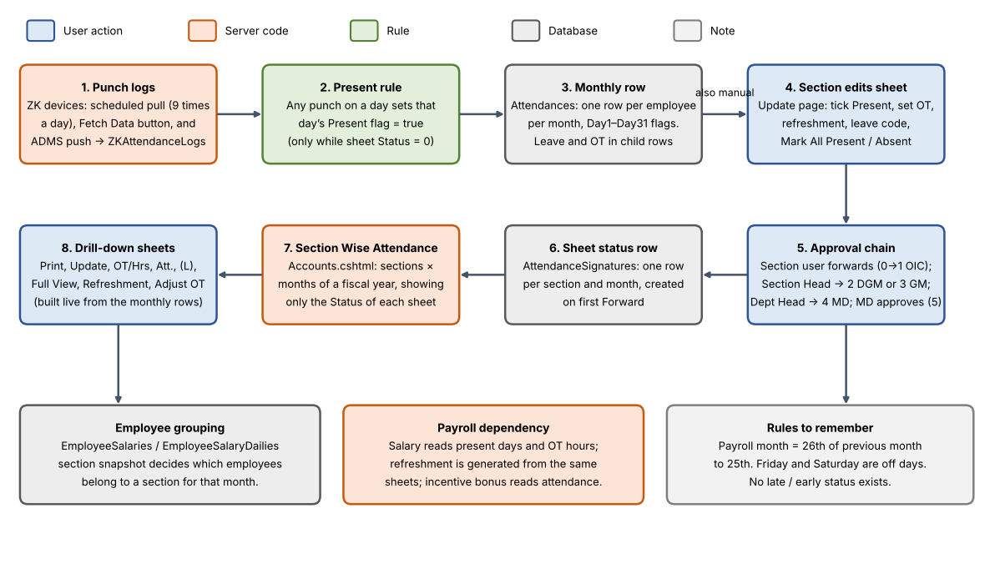

**Personnel → Section Wise Attendance – Backend Logic Analysis and Technical Documentation**

Section grid, employee grouping, attendance status rules, calculations, filters, approval status and database interaction

# Section Wise Attendance Workflow

## What happens, in simple words

•      **The menu item opens a status grid, not an attendance count.** Personnel → Section Wise Attendance goes to /Attendances/Accounts (CddlErpApp/Pages/Attendances/Accounts.cshtml). It lists every section down the page and every month of one fiscal year across the page. Each cell is a button showing the approval status of that section’s monthly attendance sheet (Pending, Sent to OIC, Sent to DGM, Sent to GM, Sent to MD or Approved). It shows no present, absent or late numbers itself. The same link is in the Admin Personnel menu (_Admin.cshtml line 217), the Managing Director menu and the Pay Section menu.

•      **The real attendance sits one click deeper.** Each cell and each month header opens a drill-down: the printable section sheet (Print), the edit sheet (Update), Att., (L) leave and OT/Hrs reports, the whole-organisation Full View (all employees, or LWP only), Refreshment and Adjust OT.

•      **Attendance is stored once per employee per month.** The table Attendances has one row per employee and payroll month with 31 true/false columns (Day1 to Day31). Leave codes, overtime hours and refreshment amounts for the same days are in three child tables (AttendanceLeaves, AttendanceOvertimes, AttendanceRefreshments). There is no table with one row per employee per day.

•      **Everything on screen is built live.** Totals (days present, leave days, LWP days, overtime hours, refreshment) and the per-employee-type summary are added up in memory every time a page opens (EmployeeAttendanceRepository.GetAttendanceData, line 130). Nothing is cached or pre-summarised. The only stored “summary” is the sheet approval status in AttendanceSignatures.

•      **Present, leave and absent are simple codes.** A day is Present when its flag is true (shown as P), otherwise it shows “-”. A leave code from 1 to 16 (10 = absent) is written in AttendanceLeaves. There is no late, early, half-day or in/out-time status anywhere in the code.

•      **Biometric punches only tick Present.** Fingerprint/face devices (ZK) are read on a schedule, by the Fetch Data button, and by a push endpoint. Any punch on a date, at any time, turns that day’s Present flag on. Times are stored in ZKAttendanceLogs but are not compared with any duty hour.

•      **Employees belong to a section by the salary record of that month.** If the month already has an EmployeeSalaries (or EmployeeSalaryDailies) row, that row’s section is used; otherwise the employee’s current section. The payroll month runs from the 26th of the previous month to the 25th.

•      **Approval is a status number on AttendanceSignatures (0 to 5).** The row is created when the section first forwards the sheet. Once the status is not 0, device punches no longer change that section’s attendance.

|**Event**|**Database interaction**|**Result on screen**|
|---|---|---|
|**User opens Section Wise Attendance**|SELECT: FiscalYears (default year from SearchDates Id 2), its Months, AttendanceSignatures for those months, Departments and DepartmentWiseSections (minus the skipped Ids). Nothing is written.|Grid of sections × months with status buttons. Months newest first. Blank cell = no signature row yet.|
|**Device punch arrives (scheduled pull, Fetch Data, or ADMS push)**|INSERT ZKAttendanceLogs (unique on DeviceId + EmployeeId + DeviceTime). Then UpdateAttendanceFromLogs: set Attendances.DayN = true for the punch date; INSERT the monthly row if missing. Skipped when the section’s sheet Status ≠ 0.|Day shows P on the sheet. Time itself is not displayed.|
|**Section user ticks a day or marks all (Update page)**|Attendances.DayN toggled (OnPostMarkPresent); Mark All Present sets every day true except days with a leave code and, for Employment Type 3, days outside contract dates; Mark All Absent sets all 31 to false.|Present total updates in the row.|
|**Overtime, refreshment or leave code entered**|UPSERT AttendanceOvertimes.DayN (hours), AttendanceRefreshments.DayN (amount) or AttendanceLeaves.DayN (code 1–16). For Employee Type 1 or 8 a refreshment amount is suggested from the hours.|Totals and the leave summary text (for example CL-2 LWP-1) refresh.|
|**Section user presses Forward**|INSERT AttendanceSignatures (Status 0) if none, then Status → 1; signature HTML and Note appended. Notification to the section’s CPF Section Head.|Cell shows “Sent to OIC”.|
|**Section Head, Deputy Department Head, Department Head, Managing Director forward**|UPDATE AttendanceSignatures.Status: 1 → 2 (DGM exists) or 3; 2 → 3; 3 → 4; 4 → 5. Signature and Note appended each time; notification to the next role.|Cell shows Sent to DGM / GM / MD, finally green “Approved”.|
|**Send Back**|Status → 0, Signature cleared, Note gets the comment. Notification to the section’s CPF Section Head.|Cell shows “Pending” (the only way status 0 appears in the grid). Section can edit again.|
|**Managing Director approves in bulk (ApproveAll)**|UPDATE Status 4 → 5 for the selected AttendanceSignatures rows.|Cells turn Approved.|
|**Approved leave posted by the Leave module**|AttendanceLeaves.DayN written by UpdateAttendanceLeave (see the Leave Entry document).|Leave code appears in the (L) row of that day.|
|**Drill-down opened (Print, Update, Att., (L), OT/Hrs, Full View)**|SELECT only: Employees, Attendances with leave, overtime and refreshment, ZKAttendanceLogs (loaded but not shown), OffDays, ContractRenewals, AttendanceLeaveCategories, AttendanceSignatures.|Section sheet or report for one month.|

  

# Diagram: Attendance Data and Approval Flow

# The Section Wise Attendance Page

| **Item**              | **How it works**                                                                                                                                                                                                                                                                                                                                                    |
| --------------------- | ------------------------------------------------------------------------------------------------------------------------------------------------------------------------------------------------------------------------------------------------------------------------------------------------------------------------------------------------------------------- |
| **Page and access**   | Accounts.cshtml(.cs), page title “Employee Attendances”. No [Authorize(Roles)] attribute: any logged-in user who opens /Attendances/Accounts sees it. Only the menu is limited (Admin Personnel, Managing Director, Pay Section).                                                                                                                                   |
| **Date filter**       | One filter: fiscal year (July to June). OnGet(fiscalYearId) calls GenericFilter.DateFilter, which uses SearchDates Id 2 to choose the year when fiscalYearId is 0. The drop-down exists but is hidden (class d-none, Accounts.cshtml line 26); the script reloads with ?fiscalYearId= when it changes, so the year can in practice be changed only through the URL. |
| **Rows (sections)**   | All Departments except Ids 9, 10 and 13, and all DepartmentWiseSections except Ids 16, 17, 23, 26, 27, 31, 32, 33, 34, 35 (hard-coded, Accounts.cshtml.cs lines 34–35). A bold department row, then its sections with a running serial number.                                                                                                                      |
| **Columns (months)**  | Every Month of the chosen fiscal year, newest first, labelled like “Mar-2026”. The first body row has two buttons per month: View LWP (Full View, LWP only) and a drop-down with View Full, View Refreshment and Adjust OT for that month.                                                                                                                          |
| **Cell content**      | Looked up in memory from AttendanceSignatures by section and month. If a row exists: a button with the status text; green only when Approved, red for all other statuses. If no row exists the cell is empty, which means the section has never forwarded that month.                                                                                               |
| **Cell drop-down**    | Update (edit sheet), Adjust OT, OT/Hrs, Att. and (L) (leave). The button itself opens Print for that section and month.                                                                                                                                                                                                                                             |
| **Search and paging** | Sorting and paging are switched off (dtPaging and dtOrdering false, line 193). Any search box comes from the shared DtBasicFixed script and is not specific to this page. The page’s own print function is commented out.                                                                                                                                           |